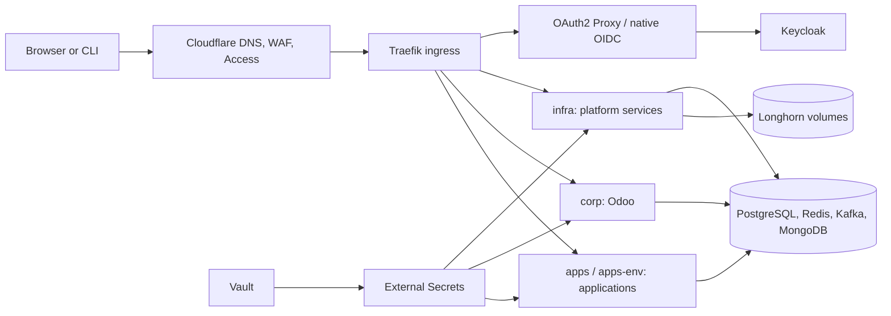
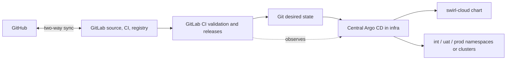
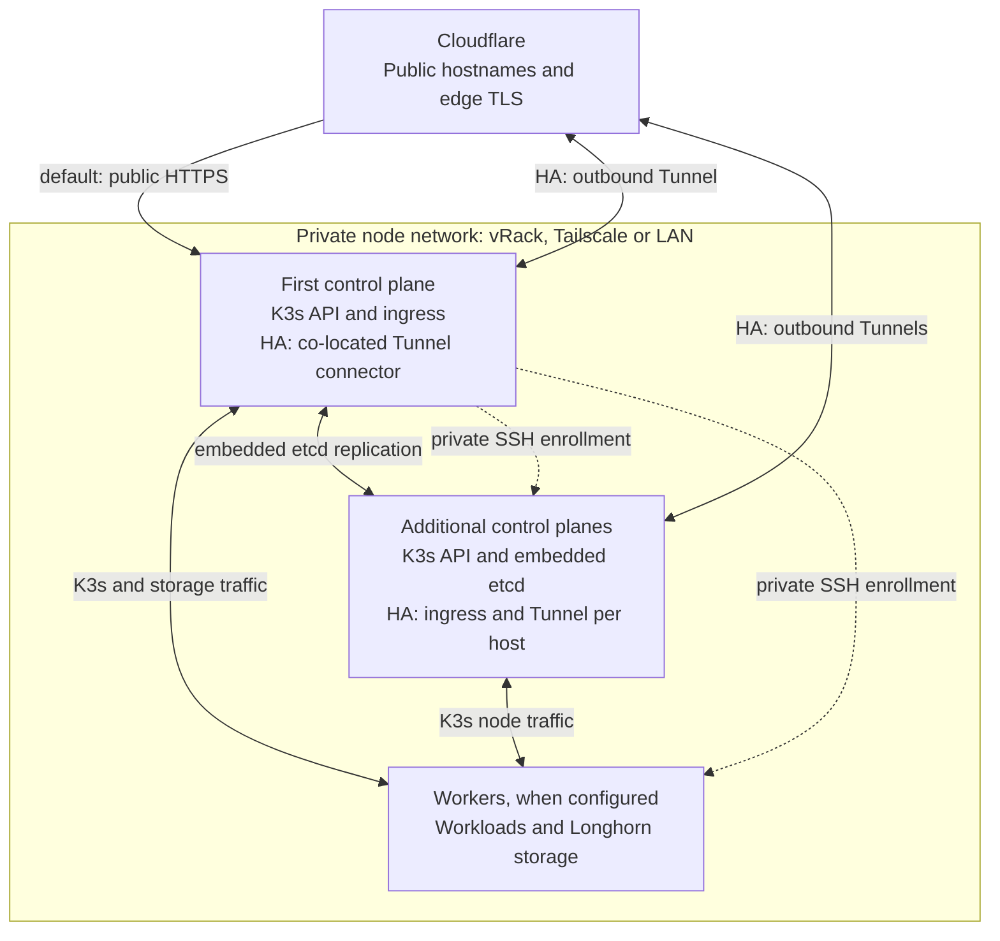

# Architecture Overview And ADR Index

This guide describes how the bare-metal platform fits together and indexes the
architecture decision records (ADRs) in [`adr/`](adr/). ADRs explain why the
platform uses a pattern, where its boundary is, and what future changes must
preserve or deliberately replace.

## System Architecture At A Glance



Delivery:



## Platform Components

| Layer | Components | Installed by |
| --- | --- | --- |
| Kubernetes | K3s `v1.36.4+k3s1` with secrets encryption, SQLite or embedded etcd, CoreDNS private zone | Installer and [node enrollment](guides/node-enrollment.md) |
| Storage | Longhorn 1.12.1, weekly trim, optional S3 backups | Shared Helm helper |
| Ingress and edge | Traefik 3.7 (direct LoadBalancer or HA DaemonSet with `cloudflared`), Cloudflare DNS/TLS/WAF/Access | [`configure-ingress.sh`](../scripts/configure-ingress.sh), [`configure-cloudflare.sh`](../scripts/configure-cloudflare.sh) |
| Secrets | Vault 2.1 (Raft), External Secrets 2.9 | Shared Helm helper and [`configure-vault.sh`](../scripts/configure-vault.sh) |
| Data | PostgreSQL 18 (optional CloudNativePG HA), Redis 8 (optional Sentinel HA), Kafka KRaft (optional three-node quorum), MongoDB 7 | Platform chart |
| Identity | Keycloak 26, OAuth2 Proxy, Cloudflare Access IdP | Platform chart |
| Delivery | GitLab CE 19 with Registry and Dependency Proxy, GitLab Runner, Argo CD 3.5 | Platform chart and shared Helm helper |
| Observability | Prometheus, Alertmanager, Grafana, kube-state-metrics, node-exporter, Elasticsearch, Logstash, Kibana, Fluent Bit, Filebeat, Trivy Operator, SonarQube | Platform chart |
| Administration | Homepage portal, Portainer, DBGate, Kafbat UI, Descheduler | Platform chart |
| Corporate | Odoo 19 in `corp` | Platform chart when `appsEnabled` |

Exact versions and digests live in [`config/platform.env`](../config/platform.env),
[`config/`](../config/) values and the owning manifests under [`k8s/`](../k8s/).

## Node topology



Solid links show runtime traffic; dotted links show enrollment. Public traffic
uses the first control plane until [HA activation](guides/high-availability.md#activate-in-order)
switches it to independent Tunnel connectors. Adding nodes alone does not change
that route. See [scheduling and storage](guides/node-enrollment.md#scheduling-and-storage)
for workload placement and [control-plane administration](guides/node-enrollment.md#control-plane-administration)
for private SSH and API access.

### Namespaces

| Namespace | Responsibility |
| --- | --- |
| `infra` | Shared platform services and Argo CD Applications |
| `apps` | Workloads managed by application repositories |
| `corp` | Centrally managed Odoo |
| `host-agents` | Node-level telemetry agents with host access (node-exporter, Fluent Bit, Filebeat) |
| `gitlab-runners` | Isolated CI jobs |
| `longhorn-system` | Persistent storage management |
| `kube-system` | Kubernetes networking and system components |

## Key Runtime Lifecycles

### Installation

1. The installer collects identity, scope, topology, components, recovery and
   public-access inputs, then renders one configuration for native manifests and
   Argo CD.
2. Host preparation installs K3s, AppArmor, recovery archives, Longhorn
   prerequisites and the exposure-specific host security policy.
3. Nodes join over the private transport; topology reconciliation sets taints and
   storage replication.
4. Helm releases (Longhorn, Traefik, Vault, External Secrets) and Cloudflare are
   reconciled, Vault is initialized and seeded, and ExternalSecrets become Ready.
5. Data stores, platform services, Keycloak SSO, GitLab CI, Odoo and the
   Descheduler are applied and awaited.
6. Argo CD is installed and the root `swirl-cloud` Application takes ownership of
   the chart. Environments and repositories are optionally registered afterward.

### Administrative request

1. Cloudflare terminates the visitor connection, applies WAF and rate rules, and
   requires an Access session backed by Keycloak for administrative hosts.
2. Traefik accepts traffic only from Cloudflare (direct) or the loopback tunnel
   connector (HA), normalizes forwarded headers and selects the Ingress.
3. Native OIDC services (GitLab, Grafana, Argo CD, Vault, Kafka UI, Portainer,
   Odoo) authenticate directly with Keycloak; the others use the shared OAuth2
   Proxy ForwardAuth middleware.
4. Membership in `platform-admins` grants administration.

### Secret delivery

1. [`configure-vault.sh`](../scripts/configure-vault.sh) generates credentials into
   Vault KV-v2 under `secret/infra/*` and scoped `secret/apps/*` paths.
2. External Secrets authenticates with Vault Kubernetes auth and projects
   namespace-scoped Secrets.
3. Workloads consume Secrets as environment variables or files; rotation writes
   Vault first and refreshes ExternalSecrets.

### Platform change

1. A commit lands on GitLab `main` (synchronized from GitHub).
2. Argo CD renders `k8s/` with the installation's Helm parameters and applies it
   with automatic sync, prune and self-heal.
3. Platform CI validates the commit and, on the default branch, waits for that
   exact revision to be `Synced`/`Healthy` before checking delivery services.

### Application delivery

1. An application repository publishes immutable images through its own CI.
2. CI commits the selected environment's image digests and pointer revision.
3. Central Argo CD reconciles that Application into its registered namespace or
   cluster; CI verifies revision, health and public smoke checks.

## Ownership Rules

- `swirl-cloud` owns the cluster, shared services, platform hostnames and Odoo.
- Application repositories own their manifests, CI, Argo CD Applications,
  hostnames, availability profile and data migrations.
- The platform has no application inventory; applications declare an
  [onboarding contract](guides/application-onboarding.md).
- Vault is the source of truth for credentials; Kubernetes Secrets are projections.
- Git is the source of truth for desired state; manual cluster edits are reverted.
- Each data service manages its own replication; Longhorn replicates blocks, not
  application consistency.

## Platform Constraints

- Installation inputs define identity; the checkout stays organization-neutral.
- Installer and GitOps render the same resources from the same inputs.
- Every image is pinned by digest; every workload declares token mounting and
  CPU/memory budgets.
- Stateful migrations are explicit, journaled and refuse implicit downgrades.
- Documentation distinguishes implemented behavior from [planned work](../TODO.md).

## Specialized Guides

These procedures have no Swirl Demo App counterpart and live under [`guides/`](guides/):

- [Node enrollment and private networking](guides/node-enrollment.md)
- [High availability](guides/high-availability.md)
- [PostgreSQL HA profile](guides/postgres-ha.md)
- [Kafka high availability](guides/kafka-ha.md)
- [Node fencing](guides/node-fencing.md)
- [Platform migration to Traefik and upstream images](guides/platform-migration.md)
- [Repository onboarding](guides/repository-onboarding.md)
- [Application onboarding contract](guides/application-onboarding.md)

## ADR Process

Add an ADR when a change:

- adds, removes or replaces a platform service or runtime dependency
- changes namespace, repository or data ownership
- changes identity, authorization, secret flow or trust boundaries
- changes durability, replication, backup or recovery guarantees
- changes installation, reconciliation or delivery ownership
- constrains how application repositories integrate with the platform

Use the next sequence number:

```text
NNNN-short-title.md
```

Statuses:

- **Proposed**: under review, not a stable platform decision
- **Accepted**: current direction
- **Superseded**: retained for history and linked to its replacement

## Accepted ADRs

- [ADR 0001: Mirror The Application Documentation Structure](./adr/0001-documentation-structure.md)
- [ADR 0002: Run One Bare-Metal K3s Platform Cluster](./adr/0002-bare-metal-k3s-platform.md)
- [ADR 0003: Use Longhorn For Replicated Persistent Storage](./adr/0003-longhorn-storage.md)
- [ADR 0006: Keep Credentials In Vault And Project Them With External Secrets](./adr/0006-vault-external-secrets.md)
- [ADR 0007: Scale Host Security Controls With Node Exposure](./adr/0007-host-security-by-exposure.md)
- [ADR 0008: Share One Contract And Renderer Between Installer, Ansible And GitOps](./adr/0008-shared-installation-contract.md)
- [ADR 0009: Front The Platform With Cloudflare And Lock The Origin](./adr/0009-cloudflare-edge.md)
- [ADR 0010: Keep Recovery Archives On The Host With Optional Encrypted Offsite Copies](./adr/0010-host-recovery-archives.md)
- [ADR 0011: Keep Nodes On A Private Transport With An Odd Embedded-etcd Quorum](./adr/0011-private-transport-and-quorum.md)
- [ADR 0012: Separate Platform, Application And Corporate Namespaces](./adr/0012-namespace-ownership.md)
- [ADR 0013: Deliver Through Self-Hosted GitLab And One Central Argo CD](./adr/0013-gitlab-argocd-delivery.md)
- [ADR 0014: Centralize Identity In Keycloak](./adr/0014-keycloak-identity.md)
- [ADR 0015: Build Observability From Prometheus, ELK, Trivy And Namespace Discovery](./adr/0015-observability-stack.md)
- [ADR 0017: Make High Availability Opt-In Through Explicit Migrations](./adr/0017-opt-in-high-availability.md)
- [ADR 0018: Require Physical Fencing Before Recovering Persistent Singletons](./adr/0018-singleton-fencing.md)
- [ADR 0019: Onboard Applications Through A Declarative Repository Contract](./adr/0019-application-onboarding-contract.md)
- [ADR 0020: Keep The Platform Organization-Neutral](./adr/0020-organization-neutral-identity.md)
- [ADR 0021: Route Through A Platform-Owned Traefik Release](./adr/0021-traefik-ingress.md)
- [ADR 0022: Pin Public Upstream Images By Digest](./adr/0022-upstream-images-by-digest.md)
- [ADR 0023: Keep A Small Permanent Deployment Safety Suite](./adr/0023-deployment-safety-suite.md)
- [ADR 0024: Serve Environments From Registered Targets With Isolated Shared Data](./adr/0024-deployment-environments.md)
- [ADR 0025: Isolate Host Agents So `infra` Can Enforce Baseline Pod Security](./adr/0025-host-agent-namespace-and-infra-pod-security.md)

## Superseded ADRs

- [ADR 0004: Route Public Traffic Through ingress-nginx](./adr/0004-ingress-nginx.md), superseded by ADR 0021
- [ADR 0005: Build With Jenkins And Store Artifacts In Nexus](./adr/0005-jenkins-nexus-delivery.md), superseded by ADR 0013
- [ADR 0016: Rebuild Vulnerable Platform Images In A Private Registry](./adr/0016-private-security-images.md), superseded by ADR 0022

## Proposed ADRs For Roadmap Work

Create decisions before implementing:

- offsite backup activation, key separation and scheduled restore drills
- `infra` default-deny network policy
- multi-factor authentication for platform administrators
- alert routing, paging and missing platform alerts
- platform SMTP relay
- HTTP intrusion detection, API audit logging and host auditd
- remote application-cluster telemetry
- migration of version-1 applications to the environment contract
- installer `.env` schema, secret redaction and TUI/web front ends
- mixed vRack/Tailscale transport and API-only (`--disable-etcd`) control planes
- directory and mail provider: Microsoft 365 versus self-hosted LDAP and mail
- password manager: Bitwarden versus Vaultwarden
- virtualization layer: Apache CloudStack versus KubeVirt
- S3 object storage for backups and GitLab: MinIO versus alternatives

## ADR Template

```markdown
# ADR NNNN: Title

- Status: Proposed | Accepted | Superseded
- Date: YYYY-MM-DD

## Context

What forces, constraints, and current facts made this decision necessary?

## Decision

What did we decide?

## Rationale

Why this option over the alternatives?

## Consequences

What becomes easier, harder, riskier, or more constrained?
```

## Related Guides

- [Features](./features.md)
- [Data Model](./data-model.md)
- [Development](./development.md)
- [Testing](./testing.md)
- [Code Quality](./code-quality.md)
- [Deployment](./deployment.md)
- [Operations](./operations.md)
- [Security](./security.md)
- [Public DNS And Ingress](./dns.md)
