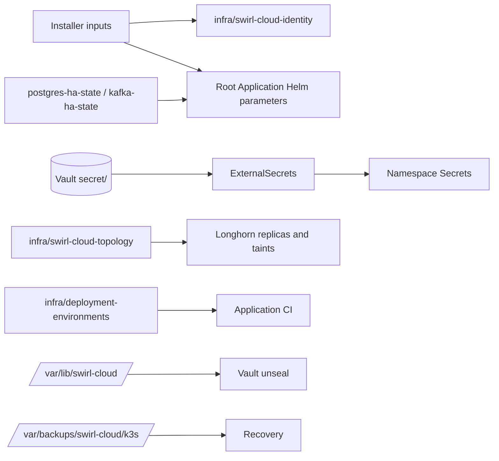

# Data Model Reference

The platform has no business domain of its own. Its data model is the set of
durable records it owns: credentials in Vault, shared databases, persistent
volumes, public state ConfigMaps and root-only host files. This reference lists
each record, its owner and how it changes. Application schemas belong to their
repositories.

## Relationship Overview

## Vault Paths

| Path | Contents | Consumers |
| --- | --- | --- |
| `secret/infra/<service>` | Administrator, database and OIDC client credentials for `postgres`, `mongodb`, `keycloak`, `grafana`, `elasticsearch`, `sonarqube`, `gitlab`, `dbgate`, `kafka-ui`, `portainer`, `monitoring`, `platform-ui`, `odoo` | Platform ExternalSecrets in `infra` and `corp` |
| `secret/infra/gitlab` | `root_password`, runner, retention and `sonar_discovery_api_token` tokens | GitLab bootstrap, runner, retention and discovery jobs |
| `secret/infra/application-redis` | Platform Redis administrator password | Platform only; never applications |
| `secret/infra/smtp` | Platform mail relay: `enabled`, host, port, TLS mode, login, sender and alert recipients; seeded with mail off ([guide](guides/platform-mail.md)) | `platform-mail` Secrets in `infra` and `corp`, Alertmanager's rendered configuration, the outage watch Worker's secret |
| `secret/apps/<app>/registry` | Verified `read_registry`/`read_repository` deploy token | Application pulls and Argo CD repository credentials |
| `secret/apps/<app>/<env>/{database,redis,kafka}` | Environment-scoped data credentials | Environment secret store (`kubernetes-<env>` auth mount) |
| `secret/apps/<website>/odoo` | Odoo URL, database, integration login and lead-intake API key, plus `inboundSecret` for emailed chat replies ([guide](guides/odoo-website.md)) | The website's ExternalSecret; the Cloudflare Email Worker |
| `secret/apps/<app>/...` | Other values declared by the onboarding contract | Application ExternalSecrets |

Policies: `external-secrets-policy` reads `infra/*` and `apps/*`; environment
roles read only their own prefix; `platform-admin` grants everything to the
Keycloak `platform-admins` group. See [recovery credentials](security.md#recovery-credentials).

## Shared Databases

| Service | Store | Owned databases or keys |
| --- | --- | --- |
| PostgreSQL (`infra/postgres`, 2 Gi) | Logical databases | `keycloak`, SonarQube, Odoo (`odoo`), per-environment application databases such as `swirl_demo_app_int`, and legacy application databases such as `swirl_demo_app_db` |
| MongoDB (`infra/mongodb`, 5 Gi) | Databases | Available to applications; no platform service or current workspace application depends on it |
| Redis (`infra/redis`, ephemeral) | Keys with environment prefixes | Disposable cache and rate-limit state; never durable jobs |
| Kafka (`infra/kafka`, 1 Gi broker, 1 Gi controller) | Topics and consumer groups with environment prefixes | Application events |

GitLab Omnibus keeps its own bundled PostgreSQL inside `gitlab-data`.

## Persistent Volumes

| Namespace / PVC | Size | Data |
| --- | ---: | --- |
| `infra/gitlab-data` | 40 Gi | Repositories, Registry, packages, artifacts, bundled database |
| `infra/gitlab-config`, `infra/gitlab-logs` | 2 Gi each | Omnibus configuration and secrets, logs |
| `infra/sonarqube-data`, `-extensions`, `-logs` | 10 / 5 / 5 Gi | SonarQube data, plugins, logs |
| `infra/elasticsearch-data` | 10 Gi | Container logs and Lynis audits |
| `infra/prometheus-data` | 4 Gi | Metrics (15 d, 1 500 MB) |
| `infra/grafana-data` | 5 Gi | Grafana database |
| `infra/portainer-data` | 10 Gi | Portainer settings |
| `infra/dbgate-pvc` | 1 Gi | DBGate workspace |
| `infra/mongodb-pvc`, `infra/postgres-v18-pvc` | 5 / 2 Gi | Shared databases |
| `infra/vault-audit` (node-local) | 5 Gi | Vault file audit log |
| `infra` Vault data (chart template) | chart default | Raft storage |
| `infra` Kafka StatefulSet claims | 1 Gi each | Controller metadata and broker logs |
| `corp/odoo-data-pvc` | 10 Gi | Odoo filestore |
| `gitlab-runners/gitlab-runner-cache` | 5 Gi | Runner cache |

Capacity requests are not physical usage; see [storage and retention](operations.md#storage-and-retention).

## Platform State Records

| Record | Contents | Written by |
| --- | --- | --- |
| `infra/swirl-cloud-identity` | Domain, internal zone, organization, GitLab, realm, TLS and Cloudflare names | Installer rendering |
| `infra/swirl-cloud-topology` | Schedulable policy, expected and ready node counts, Longhorn replicas, availability mode | [`reconcile-cluster-topology.sh`](../scripts/reconcile-cluster-topology.sh) |
| `kube-system/swirl-cloud-api-endpoint` | Kubernetes API endpoint transport, address, Tailscale name and Service | [`configure-k3s-api-endpoint.sh`](../scripts/configure-k3s-api-endpoint.sh) |
| `infra/deployment-environments` | Verified environment targets (cluster, namespace, domain, ingress, quota, secret store) | [`configure-deployment-environments.py`](../scripts/configure-deployment-environments.py) |
| `infra/postgres-ha-state`, `infra/kafka-ha-state` | Migration phase and full active HA profile | HA migration helpers |
| `infra/swirl-cloud-public-ingress` | Tunnel mode, tunnel ID and domain | Cloudflare configurator in HA |
| `infra/ingress-proxy-trust` | Trusted edge CIDRs | Traefik release |
| `infra/host-security-config` | Published host policy | Installer and Ansible |
| `infra/application-data-access` | Public data-service endpoints for environments | Platform chart |
| Root Application Helm parameters | Identity, scope, HA, fencing and application-data values | Installer, Ansible and migration helpers |
| Application `infra/onboarding.json`, `infra/onboarding-values.json` | Contract and saved public choices | Application repository and `add-repos.sh` |

## Host State

| Path | Contents |
| --- | --- |
| `/var/lib/swirl-cloud/vault-unseal-key`, `vault-bootstrap-token` | Root-only `0600` Vault recovery material |
| `/var/backups/swirl-cloud/k3s/` | Seven daily recovery archives and pre-etcd conversion backups |
| `/etc/swirl-cloud/backup.env` | Offsite backup credentials (when configured) |
| `/var/lib/swirl-cloud/backups/` | Vault HA migration snapshots and archived controllers |
| `/var/log/lynis-reports/` | Control-plane audit reports |
| `/etc/rancher/k3s/config.yaml.d/25-swirl-cloud-api-endpoint.yaml`, `/etc/keepalived/keepalived.conf` | Control-plane certificate names and VIP configuration for the Kubernetes API endpoint |
| `~/.local/state/swirl-cloud/repositories` | Onboarding journals |

## Change Rules

- Never delete a PVC or database as part of a migration; retain originals until a verified cutover.
- Record HA and data migrations in their private journals and state ConfigMaps; do not hand-edit phases.
- Change identity values only through a planned migration of accounts and resources.
- Write credentials to Vault first, then refresh ExternalSecrets.
- Keep journals, dumps, keys and inventories outside Git.

## Privacy And Retention

Container logs are deleted after about three days, Lynis audits after 365 days,
Prometheus metrics after 15 days and GitLab's embedded metrics after one day.
Registry images and packages expire after the configured retention period
(default 1 095 days). Secret-scanner reports contain metadata, not secret values.
See [storage and retention](operations.md#storage-and-retention).

## Related Guides

- [Architecture](architecture.md)
- [Security](security.md)
- [Operations](operations.md)
- [PostgreSQL HA](guides/postgres-ha.md)
- [Kafka HA](guides/kafka-ha.md)
