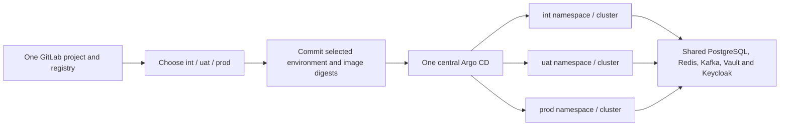

# Deployment Guide

This guide installs, reconciles and expands the shared platform, registers
application environments, and explains the delivery path shared by GitLab CI
and Argo CD. The [architecture overview](architecture.md) explains why the
platform is shaped this way; step-by-step procedures without a DevApp
counterpart live in [specialized guides](architecture.md#specialized-guides).

## Infrastructure Layout

| Entry point | Owns |
| --- | --- |
| [`install-control-plane.sh`](../install-control-plane.sh) | Guided or unattended bootstrap of the first control plane and every selected platform component. |
| [`ansible/install.yml`](../ansible/install.yml) | The same installer through Ansible, with Vault-encrypted inputs. |
| [`ansible/deploy.yml`](../ansible/deploy.yml) | Idempotent reconciliation of an installed control plane. |
| [`add-node.sh`](../add-node.sh) | Control-plane and worker enrollment; see [node enrollment](guides/node-enrollment.md). |
| [`add-repos.sh`](../add-repos.sh) | Repository import, synchronization and first deployment; see [repository onboarding](guides/repository-onboarding.md). |
| [`scripts/install-application-cluster.sh`](../scripts/install-application-cluster.sh) | Optional separate application cluster for one environment. |
| [`k8s/`](../k8s/) | The GitOps Helm chart reconciled by the root Argo CD Application. |
| [`config/`](../config/) | Shared version inventory and Helm values for separately installed releases. |

## Installation Prerequisites

Run commands from this checkout on the first control-plane host as a non-root
user with sudo access. Use Ubuntu and size CPU, memory, and disk for the
selected services' [resource and volume requests](../k8s), with headroom for
builds, snapshots, and backups. Unattended runs require passwordless sudo.

Prepare your public domain, an accessible GitOps repository, and the
[administrator credentials](security.md#administrator-sign-in). For multiple
nodes, complete the [private transport prerequisites](guides/node-enrollment.md#private-node-network)
and [remote enrollment requirements](guides/node-enrollment.md#remote-enrollment).
Interactive setup guides account configuration before changing the firewall;
unattended runs require it to be ready.

## Choose an entry point

| Task | Entry point |
| --- | --- |
| Guided installation | `./install-control-plane.sh` |
| Unattended installation | [`./install-control-plane.sh --yes`](#unattended-installation) or [Ansible installation](#ansible-installation) |
| Reconcile an installed platform | [Ansible reconciliation](#platform-reconciliation) |
| Add control planes or workers | [`./add-node.sh`](guides/node-enrollment.md) |
| Configure local or remote application environments | [Application deployment clusters](#application-deployment-clusters) |
| Import, synchronize and deploy applications | [`./add-repos.sh`](guides/repository-onboarding.md) |

For a new cluster, run:

```bash
./install-control-plane.sh
```

The assistant collects identity, installation scope, topology, components,
recovery destination, public access and administrator credentials. Accept the
recommended shared-platform bundle or select components individually.
`INSTALL_SCOPE=apps` also installs Odoo in `corp`; `infra` omits it. Both scopes
provide the `apps` namespace and its networking, credentials and TLS foundation
for [application-owned deployments](guides/repository-onboarding.md).

Existing ingress-nginx or private-image installations must first follow the
[platform migration](guides/platform-migration.md). Ordinary reconciliation stops at a
read-only migration check; `platform_migration_approved=true` is reserved for a
prepared Ansible maintenance run. Retired image-profile inputs are rejected.
New installations use public upstream images and a separate Traefik release.

## Topology and scheduling

Choose an odd final control-plane count (`1`, `3`, `5`, …) and a total count that
includes workers. Control planes must remain schedulable when there are no
workers. See the [topology and exposure model](architecture.md#node-topology) and
[scheduling and storage rules](guides/node-enrollment.md#scheduling-and-storage).
Additional hosts alone do not activate the [HA profile](guides/high-availability.md).

## Organization and installation identity

The installer renders URLs, registry paths, authentication issuers, discovery
settings and branding from your inputs; the source checkout stays generic.
The required company display name gives the portal its `<company name> Cloud`
title and cluster label. Keycloak's realm display name and Odoo's main company
use the company name without the suffix.

| Environment input | Helm value | Default or requirement |
|---|---|---|
| `ORGANIZATION_NAME` | `organizationName` | Required company display name, including spaces and punctuation; the portal appends ` Cloud`. |
| `ORGANIZATION_SLUG` | `organizationSlug` | First label of the public domain; a lowercase DNS label. |
| `PLATFORM_DOMAIN` | `publicDomain` | Required public base domain, such as `example.com`. |
| `INTERNAL_DNS_ZONE` | `internalDnsZone` | `internal.<PLATFORM_DOMAIN>`; must differ from the public domain. |
| `GITLAB_GROUP_PATH` | `gitlabGroupPath` | Organization slug; the installer provisions a top-level group. |
| `GITLAB_GROUP_NAME` | `gitlabGroupName` | Organization display name. |
| `GITLAB_PROJECT_NAME` | `gitlabProjectName` | `swirl-cloud`; platform GitLab integrations follow this choice. |
| `KEYCLOAK_REALM` | `keycloakRealm` | Organization slug; `master` is reserved for Keycloak administration. |
| `TLS_SECRET_NAME` | `tlsSecretName` | Public domain with dots replaced by hyphens, plus `-tls`; shared by ingress and certificate provisioning. `CLOUDFLARE_TLS_SECRET_NAME` is an alias. |
| `SONAR_ALM_SETTING` | `sonarAlmSetting` | `<organization-slug>-gitlab`; the managed Sonar GitLab integration. |
| `CLOUDFLARE_ACCESS_IDP_NAME` | `cloudflareAccessIdpName` | `<organization-name> Keycloak`; identifies the managed Access identity provider. |
| `CLOUDFLARE_ACCESS_TEAM_NAME` | `cloudflareAccessTeamName` | Existing Zero Trust team label, or `swirl-cloud-<domain-with-hyphens>` for a new team. |
| `GITOPS_REPOSITORY_URL` | `gitopsRepositoryURL` | Accessible HTTP(S) `.git` URL; interactive setup suggests the checkout's remote. |

The generated Argo CD Application carries these settings into subsequent Helm
reconciliation. The public `infra/swirl-cloud-identity` ConfigMap records installed
choices for installer reruns, Ansible, and provisioning helpers. Explicit
environment inputs override stored choices. Credentials stay in the
[secret-management flow](security.md#recovery-credentials).

To rebrand an existing installation, update `organizationName` in the installed
`swirl-cloud` Argo CD Application's Helm parameters and reconcile the platform.
Use the same `ORGANIZATION_NAME` for installer or Ansible overrides. Display
settings such as `GITLAB_GROUP_NAME` and `CLOUDFLARE_ACCESS_IDP_NAME` are stored
separately; update them explicitly when their labels also need to change.
Keep the domain, organization slug, SSO realm and repository paths unchanged
when changing display names.

For an existing installation created before this identity contract, preserve its
current realm, GitLab group/project, TLS secret, organization name, and integration
names as explicit Helm parameters on the installed `swirl-cloud` Application
**before syncing the generalized chart**. Supply the same values to a first
installer/Ansible rerun. This records the existing identity; changing a realm,
domain, or repository path is a separate migration of accounts and resources.

## Unattended installation

`--yes` selects the recommended component bundle and defaults to
`INSTALL_SCOPE=apps`. This example uses local exposure; replace the identity,
node name and GitOps URL with your own values:

```bash
export ORGANIZATION_NAME='Example Company'
export ORGANIZATION_SLUG=example
export PLATFORM_DOMAIN=example.com
export CONTROL_PLANE_NODE_NAME=control-plane-01
export SERVER_EXPOSURE=local
export INSTALL_SCOPE=apps
export CONTROL_PLANE_COUNT=1 CLUSTER_NODE_COUNT=1
export CONTROL_PLANE_SCHEDULABLE=true
export GITOPS_REPOSITORY_URL=https://github.com/example/swirl-cloud.git
export KEYCLOAK_SSO_BOOTSTRAP_USERNAME=platform-admin
read -rsp 'Platform administrator password: ' KEYCLOAK_SSO_BOOTSTRAP_PASSWORD
echo
export KEYCLOAK_SSO_BOOTSTRAP_PASSWORD
./install-control-plane.sh --yes
unset KEYCLOAK_SSO_BOOTSTRAP_PASSWORD
```

Identity inputs and defaults are listed [above](#organization-and-installation-identity).
Other installation inputs are:

| Input | Meaning |
| --- | --- |
| `INSTALL_SCOPE` | `apps` includes Odoo; `infra` omits it. |
| `SERVER_EXPOSURE` | `local` or `internet`; internet exposure enables the public host policy and defaults to Cloudflare configuration. |
| `CONTROL_PLANE_NODE_NAME` | Local Kubernetes node name; defaults to the lowercase host name. |
| `CONTROL_PLANE_COUNT`, `CLUSTER_NODE_COUNT` | Desired final counts, including registered nodes; the control-plane count must be odd. |
| `CONTROL_PLANE_SCHEDULABLE` | `true` permits workloads on all control planes; `false` applies `NoSchedule` after workers are Ready. Defaults to `true` without workers, otherwise `false`. |
| `K3S_NODE_TRANSPORT` | `vrack` or `tailscale` for multi-node enrollment. |
| `K3S_CONTROL_PLANE_IPS`, `K3S_WORKER_IPS` | Comma-separated prepared vRack addresses; exclude the first host. |
| `K3S_CONTROL_PLANE_HOSTS`, `K3S_WORKER_HOSTS` | Comma-separated Tailscale bootstrap SSH targets such as `admin@host`; private addresses are discovered. |
| `K3S_CONTROL_PLANE_SSH_USER`, `K3S_WORKER_SSH_USER` | SSH users for address-based enrollment. |
| `CLOUDFLARE_NODE_DNS_LABEL` | Public administration label, independent of the Kubernetes node name; defaults to `node-01`. |
| `CLOUDFLARE_PUBLISH_APEX` | `false`; opt in only if the platform should manage apex DNS. |

For example, after supplying identity, credentials and the
[Tailscale inputs](guides/node-enrollment.md#tailscale):

```bash
CONTROL_PLANE_COUNT=3 CLUSTER_NODE_COUNT=5 CONTROL_PLANE_SCHEDULABLE=false \
K3S_NODE_TRANSPORT=tailscale \
K3S_CONTROL_PLANE_HOSTS='admin@cp-02,admin@cp-03' \
K3S_WORKER_HOSTS='admin@worker-01,admin@worker-02' \
  ./install-control-plane.sh --yes
```

On retries with a partial list of new hosts, set both final counts explicitly.
Registered nodes count even when NotReady; completion requires the planned nodes
to be Ready. Reruns preserve installed K3s by default and do not upgrade it.
Use [node enrollment](guides/node-enrollment.md) for later expansion.

### Optional integrations

Use the same integration credentials with either entry point. Keep secrets in
hidden prompts, the process environment or Ansible Vault; never commit
credentials or generated cluster configuration.

- **Public DNS, TLS and Access:** follow [Cloudflare setup](dns.md#cloudflare)
  for tokens, allowed emails, the existing Zero Trust team and account
  prerequisites. In the shell installer, `CONFIGURE_CLOUDFLARE=false` uses local
  TLS while preserving existing TLS secrets; public DNS/TLS then needs separate
  configuration.
- **Encrypted offsite backups:** set `CONFIGURE_OFFSITE_BACKUPS=true`,
  `BACKUP_S3_ENDPOINT`, `BACKUP_S3_BUCKET`, `BACKUP_S3_REGION`,
  `BACKUP_S3_ACCESS_KEY`, `BACKUP_S3_SECRET_KEY` and `BACKUP_REPOSITORY_PASSWORD`.
  Keep the password outside the cluster; see
  [backup and recovery](operations.md#backups-and-recovery).
- **Repository import and deployment:** set `CONFIGURE_REPOSITORY_SYNC=true`
  and supply the [onboarding automation inputs](guides/repository-onboarding.md#automation-and-reruns).
  The installer calls `add-repos.sh` after platform and Argo CD readiness,
  forwarding `--yes` for unattended runs. Selecting deployment authorizes the
  app configuration commits and service changes described in that guide.

## Ansible

Both playbooks run locally from this checkout using the supplied `localhost`
inventory. Adding inventory hosts does not distribute installation; node
enrollment uses SSH. Bootstrap and default-mode reconciliation run on the first
control plane; an HA platform can be reconciled from a surviving control plane.

The playbooks share [platform defaults](../config/platform.env), manifest
inventories and provisioning helpers with the shell installer. Longhorn, Vault,
External Secrets and Argo CD releases use
[`reconcile-platform-release.sh`](../scripts/reconcile-platform-release.sh)
for chart options and readiness; each entry point controls selection and order.
Vault readiness follows resource application and precedes secrets bootstrap.

### Ansible installation

Install the prerequisites on the first Ubuntu host:

```bash
sudo apt-get update
sudo apt-get install -y ansible git python3
```

Export the [unattended inputs](#unattended-installation), then run the full
installer through Ansible:

```bash
ansible-playbook -i ansible/inventory ansible/install.yml
```

An optional `installer_environment` mapping overrides selected process inputs.
For example, store this mapping in an Ansible Vault encrypted extra-vars file:

```yaml
installer_environment:
  ORGANIZATION_NAME: Example Company
  ORGANIZATION_SLUG: example
  PLATFORM_DOMAIN: example.com
  CONTROL_PLANE_NODE_NAME: control-plane-01
  SERVER_EXPOSURE: local
```

```bash
ansible-playbook -i ansible/inventory ansible/install.yml \
  -e @/secure/cluster-install.yml --ask-vault-pass
```

The installation task uses `no_log` because nested commands handle secrets.
Failures stop the play; run the shared installer with the same inputs for visible
diagnostics.

### Platform reconciliation

Use `ansible/deploy.yml` on an installed control plane with its matching
kubeconfig, kubectl, Helm, jq, OpenSSL, Git, Python and Ansible. Preflight verifies
the local K3s service, control-plane role and kubeconfig before host changes.
Workers are rejected; joined private control planes are accepted when HA is
requested or already recorded.

Supply `KEYCLOAK_SSO_BOOTSTRAP_USERNAME` and `KEYCLOAK_SSO_BOOTSTRAP_PASSWORD`
through the secret environment when reconciling platform services, then run:

```bash
ansible-playbook -i ansible/inventory ansible/deploy.yml
```

Installed [identity settings](#organization-and-installation-identity) are reused
unless explicitly overridden. Set `CONTROL_PLANE_NODE_NAME` if the registered
name differs from the local hostname. Exposure defaults to `internet`; use
`-e server_exposure=local` for a locally exposed bootstrap host. Joined servers
retain their private exposure.

The playbook preserves control-plane scheduling unless
`CONTROL_PLANE_SCHEDULABLE=true|false` explicitly changes it, reconciles
[private SSH access](guides/node-enrollment.md#control-plane-administration) from
registered control-plane addresses, and applies the shared
[storage placement rules](guides/node-enrollment.md#scheduling-and-storage).

Before activating HA, complete the PostgreSQL, Kafka and Vault migrations in
[activation order](guides/high-availability.md#activate-in-order). Reconcile with
`HIGH_AVAILABILITY_ENABLED=true` and `PLATFORM_HA_VALUES_FILE`, including
`-e configure_cloudflare=true` for the public Tunnel/DNS cutover. The playbook
preserves recorded HA on later runs and rejects unfinished migrations or
implicit downgrades.

Feature switches select tasks and automatically include their dependencies:
Odoo needs platform services, those services need data stores, data stores need
Vault/External Secrets, and Cloudflare needs ingress.

| Switch | Default |
| --- | --- |
| `install_longhorn`, `install_ingress`, `install_vault_stack` | `true` |
| `deploy_data_stores`, `deploy_platform_services` | `true` |
| `install_apps`, `install_odoo` | `true` |
| `install_descheduler`, `install_argocd`, `manage_host_security` | `true` |
| `configure_cloudflare`, `manage_private_transport` | `false` |

`-e install_apps=false` omits Odoo while retaining the shared `apps` foundation.
Disabling a switch does not uninstall components; Argo CD continues reconciling
its configured scope. Application deployments remain owned by their repositories.

### Optional host and account changes

Private transport reconciliation is opt-in and runs before K3s network binding
and UFW. Export the [transport inputs](guides/node-enrollment.md#private-node-network) and
choose the existing transport:

```bash
# Already attached and addressed vRack:
ansible-playbook -i ansible/inventory ansible/deploy.yml \
  -e manage_private_transport=true -e k3s_node_transport=vrack

# Tailscale, with its API token supplied in the environment:
ansible-playbook -i ansible/inventory ansible/deploy.yml \
  -e manage_private_transport=true -e k3s_node_transport=tailscale
```

For API-managed vRack attachment, add `-e ovh_vrack_automate_account=true`
and the OVH account inputs. Without transport reconciliation, supply
`K3S_NODE_NETWORK_CIDR` when host security must trust node traffic.

Cloudflare requires its [integration inputs](#optional-integrations) and
`-e configure_cloudflare=true`. Offsite recovery and repository import use the
same optional inputs as installation. Repository setup uses `no_log`, waits for
required app jobs and readiness, and stops the play on failure. Run `add-repos.sh`
with the same inputs and state directory for visible diagnostics and recovery.

To request [local administrator password alignment](security.md#rotate-local-administrator-passwords):

```bash
read -rsp 'Local administrator password: ' LOCAL_ADMIN_PASSWORD
echo
export LOCAL_ADMIN_PASSWORD ROTATE_LOCAL_ADMIN_PASSWORDS=true
ansible-playbook -i ansible/inventory ansible/deploy.yml
unset LOCAL_ADMIN_PASSWORD ROTATE_LOCAL_ADMIN_PASSWORDS
```

The task passes the secret through stdin with `no_log`; it does not change SSO
identities or application users.

## Application deployment clusters

Install the shared platform once. `int`, `uat` and `prod` can run in separate
namespaces on that cluster, or an environment can use its own application cluster.
GitLab, Argo CD, Vault, registry, Keycloak and data services remain shared.

Copy [`deployment-environments.example.yaml`](../config/deployment-environments.example.yaml)
outside the checkout and supply your domain, ingress address and pod CIDR. The
example uses the existing cluster. `mode: local` reuses its controllers and
networking; `mode: remote` requires a separate cluster and Tailscale connectivity.

| Environment | Default local namespace | Example application hostname |
| --- | --- | --- |
| `int` | `apps-int` | `devapp-int.example.com` |
| `uat` | `apps-uat` | `devapp-uat.example.com` |
| `prod` | `apps-prod` | `devapp.example.com` |

Each local environment has a distinct namespace, restricted Argo project, Vault
store, network rules and resource quota. In suffix mode, application ingress uses
the shared Traefik certificate kept in `infra`; branch workloads never receive
its private key. Set `resourceQuota` in its inventory
entry to fit available capacity. Environments on the same cluster share its
outages, upgrades and underlying resources; quotas limit application consumption.
The legacy `apps` namespace keeps existing deployments until an explicit cutover.

`platform.hostnameStyle: suffix` produces the hostnames above and uses ordinary
base-domain wildcard certificate coverage. `nested` produces
`devapp.int.example.com` and `devapp.uat.example.com`; omitted values retain this
older style. The application label and company domain remain installation inputs.

### Register an environment

First prepare [shared data authentication](guides/application-onboarding.md#shared-application-data).
Keep administrator kubeconfigs, Vault tokens and TLS keys outside Git. Register a
local environment from the platform administration host:

```bash
python3 scripts/configure-deployment-environments.py \
  --config /secure/deployment-environments.yaml --environment int \
  --platform-kubeconfig "$HOME/.kube/config" \
  --vault-token-file /var/lib/swirl-cloud/vault-bootstrap-token
```

Repeat for `uat` and `prod`. Supply `CLOUDFLARE_API_TOKEN` for origin certificates,
or `--tls-cert` and `--tls-key` for a certificate covering the environment domain
and its wildcard. Existing valid certificates are reused. Registration verifies
cluster identity, scoped API and Vault access, authenticated data services and
TLS before publishing the target in `infra/deployment-environments`.

For installer-driven registration, set `DEPLOYMENT_ENVIRONMENTS_FILE` to this
prepared inventory when running `install-control-plane.sh`. After platform setup,
the installer registers its local entries before repository onboarding. Data
authentication and certificate prerequisites still apply; remote entries are
registered separately with their target kubeconfig.

### Optional separate application cluster

A remote entry specifies `mode: remote`, a unique `clusterName` and HTTPS `server`,
its `ingressAddress`, `podCIDR` and disjoint Tailscale `nodeCIDRs`. Its namespace
can be configured and defaults to `apps`. Set `platform.gateway` and shared
service endpoints to the protected Tailscale gateway; the
[inventory schema](../scripts/lib/deployment_environments.py) validates these
inputs. In a mixed inventory, local entries can supply a complete `services`
override for cluster-local endpoints. Kafka broker advertisements must remain
reachable from every selected environment.

On each prepared Ubuntu target, install `python3-yaml`, `curl`, `jq`, `openssl`,
`nftables` and Tailscale, then run as a sudo-capable user:

```bash
./scripts/install-application-cluster.sh \
  --config /secure/deployment-environments.yaml --environment prod
```

Remote bootstrap installs pinned K3s and its network guard, with no duplicate
platform services. It refuses to convert an unrelated cluster. Transfer the
generated administrator kubeconfig securely, then use the registration command
above with `--environment prod --target-kubeconfig /secure/apps-prod.yaml`.
Registration installs the remote ingress and secret controllers and verifies
Tailscale routes and the shared-service gateway. Do not run remote bootstrap on
the platform host. See [application node enrollment](guides/node-enrollment.md#application-cluster-nodes)
for expansion and [observability](operations.md#namespace-and-discovery) for
remote collection requirements.

### Publication and maintenance

Only registered targets are deployable. Run [repository onboarding](guides/repository-onboarding.md#environment-deployment)
to prepare application data, identity, DNS and CI access, then use the GitLab
environment dropdown. Reruns preserve cluster/namespace identities; changing an
existing binding requires an explicit migration. `--rotate-argocd-token` verifies
a replacement operator credential before revoking the previous one. Local
registration never replaces Argo CD's built-in cluster credentials.

Cloudflare needs active edge coverage for each application hostname. The default
suffix example works with `*.example.com`; nested names need additional coverage.
The [DNS helper](../scripts/configure-application-dns.py) checks coverage before
publishing records. For nested names, prepare Advanced/Custom edge coverage;
Total TLS alone needs DNS first and cannot satisfy this pre-publication check.
Certificate preparation does not move production traffic. Preserve the existing
production database and verify the replacement application before its cutover.

### Prepare application CI before targets exist

Version 2 onboarding configures the [scoped project runners](#application-delivery)
automatically. For an existing GitLab project whose target machines are not ready,
protect its default branch, finish any active jobs, and prepare CI independently:

```bash
python3 scripts/configure-application-delivery.py \
  --application devapp --project team/devapp --checkout /path/to/devapp
```

Run from the shared platform administration host. The command acquires and revokes
a temporary GitLab administrator token, or uses `GITLAB_ADMIN_TOKEN` if supplied.
It discovers registered targets from the platform; with none registered, jobs can
build but have no Application write permissions. Runner credentials stay in a
central Kubernetes Secret, and job caches are ephemeral. Rerun application
onboarding after registering targets to provision data, DNS and deployment access.

## Delivery Flow

The platform supplies GitLab, an instance runner, registries and Argo CD.
Application repositories own their CI, runtime manifests and Applications.
Use [repository onboarding](guides/repository-onboarding.md) to import or deploy an app;
this section explains the shared delivery path and how to maintain it.

### Ownership and bootstrap

The [root Application](../k8s/addons/swirl-cloud-application.yaml) reconciles the
platform chart, including Odoo when enabled. Each external application has its
own Application and deployment guide. Application runtime changes belong in that
repository; the platform has no application repository inventory.

The installer and [Ansible](#ansible) run
[configure-gitlab-ci.sh](../scripts/configure-gitlab-ci.sh) to reconcile the
configured group/project, Dependency Proxy, retention policies, instance runner
and Vault-backed tokens. Setup creates a temporary GitLab administrator token
through `gitlab-rails` on the control plane and revokes it on exit. No manually
created token is required.

### Pipelines and outputs

#### Application delivery

DevApp uses one GitLab project and registry for all environments. In **Build →
Pipelines → New pipeline**, select `PIPELINE_MODE=full` and the destination:

- `int`: select any branch to build and deploy a snapshot, including source
  versions ending in `-SNAPSHOT`. All branches share the integration hostname.
- `uat` or `prod`: select the default branch to publish and deploy a stable
  release, or set `RELEASE_VERSION` to promote a finalized release without rebuilding.

Existing releases can also deploy to `int`. Snapshots cannot deploy to `uat` or
`prod`. Older feature branches must first merge or rebase the updated CI helpers.



Each Application (`devapp-int`, `devapp-uat`, `devapp-prod`) uses its own restricted
AppProject, registered cluster/namespace pair and immutable runtime configuration commit.
A second commit records that revision in the selected Application. Updating
shared source or deploying integration therefore does not move the production
pointer. CI verifies destination, revision, deployment health, image digests and
public smoke checks; it never patches workloads directly.

The central `infra/deployment-environments` ConfigMap contains only successfully
registered targets. CI reads this public inventory, without access to
administrator credentials. It rejects missing targets and a changed cluster
binding. Register targets and provision each application's scoped services
through [installation](#application-deployment-clusters) and
[onboarding](guides/repository-onboarding.md#environment-deployment), then select the
destination in CI. Shared GitLab, registry, Argo CD and identity URLs keep the
platform domain; application hosts follow the configured suffix or nested naming style.

Release/version publication shares one lock because it changes the same branch
and version counter. Deployments use a lock per environment and reject a stale
branch before publication. Snapshot GitOps commits live on a dedicated
`gitops/int/<pipeline-id>` branch and leave the source/default branches and stable
version counter unchanged.

Version 2 onboarding gives each application project its own integration and
protected-release runners on the central platform, and disables shared runners
for that project. Branch jobs can update only their integration Application.
Protected release jobs can update their application's registered environments;
Kubernetes admission rules bind those Applications to their assigned destinations.
Existing version 1 applications keep their current runner configuration.

GitHub/GitLab synchronization still connects one repository pair. Existing
applications retain their own delivery contracts until explicitly migrated;
DevApp is the first environment-aware implementation. See the app's deployment
guide for its job details and the [scanner contract](operations.md#source-analysis)
for analysis-only pipelines. Remote metrics/log shipping requires a collector;
central namespace discovery does not automatically extend to another cluster.

#### Infrastructure reconciliation and verification

The [platform pipeline](../.gitlab-ci.yml) and Argo CD act independently:

| Path | Responsibility |
| --- | --- |
| Argo CD | Reconcile `main` into platform resources with automatic sync, prune and self-heal. |
| CI | Run [repository validation](testing.md#validation); on the default branch, verify the same commit is Synced/Healthy and check delivery services and Registry push/read. |

CI observes reconciliation; it does not gate the start of Argo's sync.
The separately installed Argo CD Helm release follows the upgrade procedure below.

### Registry and dependencies

Use the [service DNS and registry routing contract](dns.md#service-dns-and-registry-routing)
for public names, internal CI/containerd routes and the Dependency Proxy. These
machine endpoints must remain usable without browser-only authentication or challenges.

The infrastructure pipeline pins its public Alpine image by digest; the runner's
`IfNotPresent` policy reuses the node-local image. The group Dependency Proxy can
accelerate upstream pulls. Maven/npm use their public upstreams and the persistent
[runner cache](../k8s/platform/gitlab-runner.yaml); app builds may use disposable
Kaniko layers. A cold pipeline must still build, test and release successfully.

[Operations](operations.md#gitlab-storage) owns Registry/package retention and
storage cleanup. [Observability](operations.md#observability) covers delivery metrics and logs.

## Argo CD operations

The installer and `ansible/deploy.yml` install Argo CD through Helm using rendered
[`config/argocd-values.yaml`](../config/argocd-values.yaml) and version pins from
[`config/platform.env`](../config/platform.env). The root Application manages
platform resources after bootstrap; it does not upgrade its own Argo CD Helm
release. Reconcile Helm changes through the installer, Ansible, or a Helm upgrade
with those same rendered inputs and pins.

With `HIGH_AVAILABILITY_ENABLED=true`, the installer and Ansible also apply
[`config/argocd-ha-values.yaml`](../config/argocd-ha-values.yaml). API/repository
servers and ApplicationSet controllers run in pairs on separate hosts. The
disposable Redis cache uses three Sentinel peers with authenticated Redis and
Sentinel connections, two HAProxy endpoints, and disruption budgets.

The application controller remains one active process. The overlay enables
upstream [dynamic cluster distribution](https://argo-cd.readthedocs.io/en/stable/operator-manual/dynamic-cluster-distribution/)
to run it as a Deployment, with 30-second not-ready/unreachable tolerations so
Kubernetes can replace it on a surviving host. With one replica it processes
the whole cluster; there is no second controller acting as a standby. GitOps
reconciliation pauses while the replacement starts and rebuilds its cache.
Upstream marks this mechanism alpha, so check its chart behavior during upgrades.
Existing applications continue running during that pause.

The application controller caches cluster resources. Its `GOMEMLIMIT` is kept
below the container memory limit to leave room for non-Go allocations and
transient work. This is a soft Go runtime limit, not a hard process bound. Keep
the values together in `config/argocd-values.yaml`; see the upstream
[Argo CD memory guidance](https://argo-cd.readthedocs.io/en/stable/operator-manual/high_availability/#mitigating-oomkilled-events-from-memory-spikes).

After a Helm change, wait for the controller rollout and check that Applications
return to `Synced` and `Healthy`. Confirm `go_gc_gomemlimit_bytes` matches the
configured value and observe restarts, working memory, garbage collection, CPU
and reconciliation duration across startup and normal cycles. If memory pressure
persists, inspect the live heap/cache and adjust both budgets within node capacity.

## Verify the result

The installer waits for selected components and reports their endpoints. Check
cluster and GitOps status, then open `https://cloud.<your-domain>`:

```bash
kubectl get nodes
kubectl get applications -n infra
./scripts/validate-repository.sh --live
```

For source changes and Ansible syntax checks:

```bash
ansible-playbook -i ansible/inventory --syntax-check ansible/install.yml
ansible-playbook -i ansible/inventory --syntax-check ansible/deploy.yml
./scripts/validate-repository.sh
```

The live validator uses Kubernetes server-side dry-run without mutation.
`install.yml --check` skips installation; `deploy.yml` rejects check mode because
its tasks depend on command results. Validation does not replace a fresh
installation on disposable hosts. See [validation coverage](testing.md#validation)
and [Argo CD operations](#argo-cd-operations) for ongoing maintenance.

## Related Guides

- [Architecture](architecture.md)
- [Public DNS And Ingress](dns.md)
- [Operations](operations.md)
- [Security](security.md)
- [Testing](testing.md)
- [Node enrollment](guides/node-enrollment.md)
- [High availability](guides/high-availability.md)
- [Repository onboarding](guides/repository-onboarding.md)
